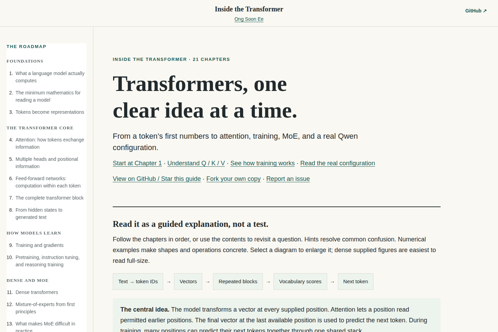

# Transformers, one clear idea at a time

An interactive guide to how language-model transformers work: intuition first, small numerical examples next, equations after the idea makes sense.

## [Read the tutorial online](https://ongsoonee.github.io/llm-transformer-learning/)



## What's inside

- 21 chapters, from token IDs and vectors to a real Qwen configuration.
- 14 original supplied diagrams with enlarge/zoom controls.
- Worked calculations with explicit tensor shapes and a consistent row-vector convention.
- Interactive attention scores, causal masking, prefill/decode, and recurrent-state examples.
- Training, shared gradients, LoRA, dense versus MoE models, KV caches, and hybrid sequence mixing.
- Full supplied Qwen3.5-397B-A17B configuration and linked references.
- Chapter contents, a plain-English glossary, mobile layouts and browser print support.

Examples with small matrices and numbers are teaching examples, not actual measured Qwen activations. Architecture comparisons are documented snapshots; check linked official sources for later changes.

## Run locally

```sh
python3 -m http.server 8000
```

Open `http://localhost:8000` from the repository directory. You can also open `index.html` directly.

## Contributions

Found an incorrect formula, unclear explanation, broken control, or stale reference? [Open an issue](https://github.com/OngSoonEe/llm-transformer-learning/issues) with the chapter number and a suggested correction. Fork the repository and submit a pull request for improvements. If this guide helps you, a star makes it easier for others to find.

See [CONTRIBUTING.md](CONTRIBUTING.md) for editing and verification guidance.

## Privacy and counts

GitHub hosts the site under its own service policies.

## Attribution and reuse

Created by OngSoonEe from his previously conducted class and workshops. This is an independent learning resource, not an official Qwen, Intel, or any organization. Sources and diagram caveats appear beside the relevant explanations and in the tutorial's source index.

See [LICENSE.md](LICENSE.md) for the distinction between original tutorial prose/code and supplied or third-party material.
